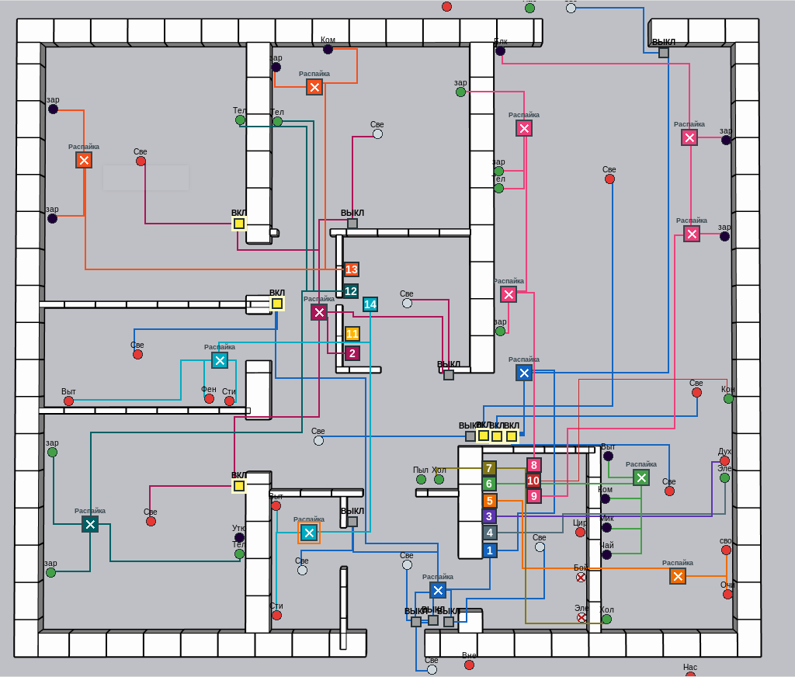
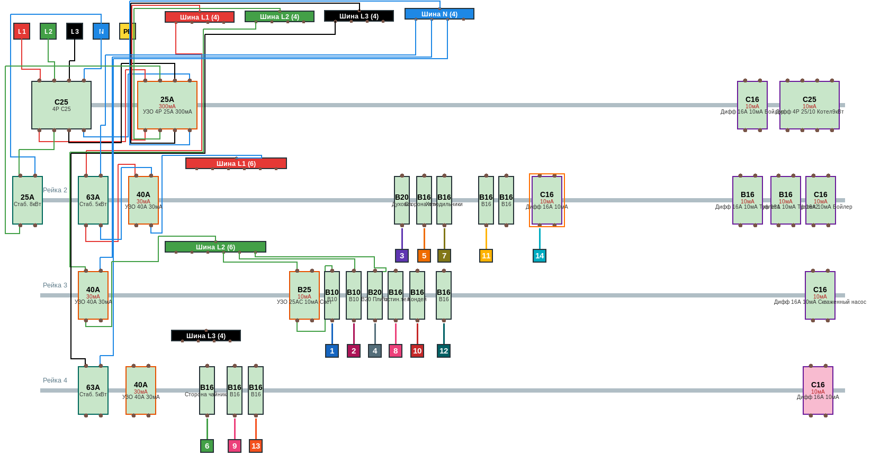

# 3phase380

Калькулятор распределения нагрузки приборами по 3-ем фазам. Cos (fi) я убрал из учета. Везде она равна 1. Учитывается входное напряжение по фазам при вычислении тока. (я на фазу 2 поставил выпрямитель)

Розетки можно соединить выключателями, распределительные коробки имеют цветовую маркировку как и у выхода с автомата.
Добавил вкладку ЩИТ. В нем можно нарисовать щит будущий и посмотреть как удобнее расположить элементы

Главная фишка программы в наглядном распределении нагрузки в доме по постоянным, временным и другим потребителям с учетом зимы и лета.

