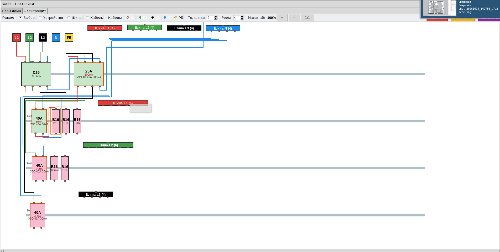

# 3phase380
Калькулятор распределения нагрузки приборами по 3ем фазам.
Розетки можно соединить выключателями.
Добавил вкладку ЩИТ. В нем можно нарисовать щит будущий и посмотреть как удобнее расположить элементы

