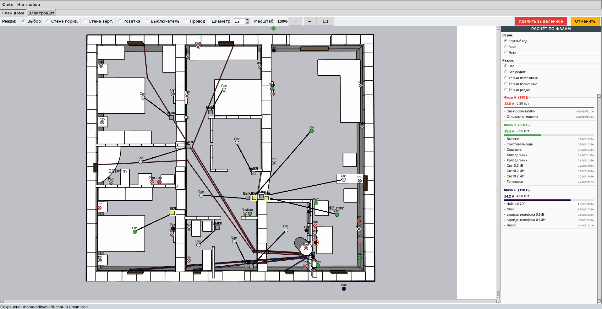
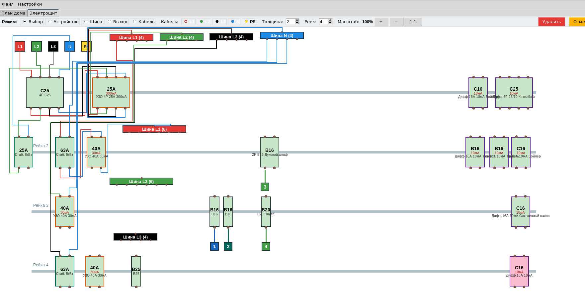

# 3phase380
Калькулятор распределения нагрузки приборами по 3ем фазам. Cos (fi) я убрал из учета. Везде она 1. Учитывается входное напряжение по фазам при вычислении тока. (я на фазу 2 поставил выпрямитель)
Розетки можно соединить выключателями.
Добавил вкладку ЩИТ. В нем можно нарисовать щит будущий и посмотреть как удобнее расположить элементы

Версия:

- 0.3 - объединил щит с проводкой и теперь все едино симулируется.

